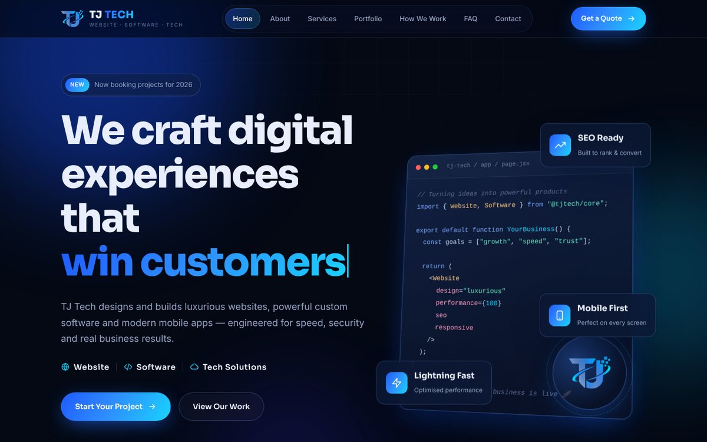
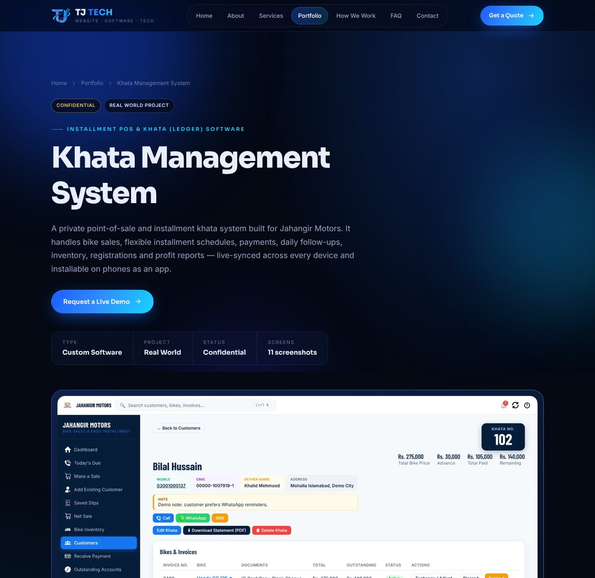
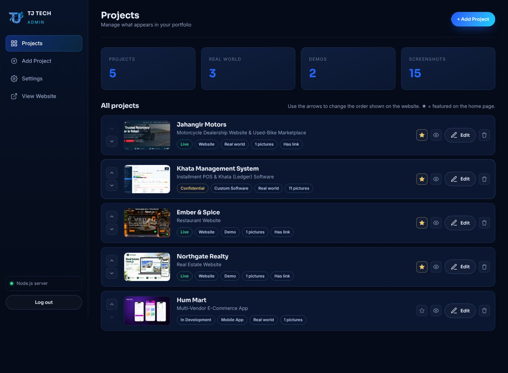

<p align="center">
  
</p>

<h1 align="center">TJ Tech — Official Website</h1>

<p align="center">
  <b>Website &nbsp;|&nbsp; Software &nbsp;|&nbsp; Tech Solutions</b><br>
  Premium websites, custom business software and mobile apps — by Tanveer Jahangir.
</p>

<p align="center">
  <a href="https://tjtech-website.tanveerjahangir63.workers.dev/"><b>🌐 Live website</b></a> ·
  <a href="https://tjtech-website.tanveerjahangir63.workers.dev/portfolio.html">Portfolio</a> ·
  <a href="https://tjtech-website.tanveerjahangir63.workers.dev/contact.html">Contact</a>
</p>

<p align="center">
  
</p>

---

## About

This is the source code of the TJ Tech agency website: a fast, animated, multi-page portfolio built with **plain HTML, CSS and JavaScript** — no framework and no build step. Projects are data-driven and managed from a built-in **admin dashboard** that saves straight to this repository, so the live site updates automatically after every change.

## Features

**Website**
- 8 pages: Home, About, Services, Portfolio, a case-study page for every project, How We Work, FAQ and Contact
- Animations: preloader, page transitions, particle hero, typing effects, scroll reveals, counters and a 3D code window
- Portfolio with filters, plus case-study pages with screenshot galleries (lightbox), features and tech stack
- 12-step animated "How We Work" journey map
- Searchable FAQ with categories
- Working contact form and newsletter (Web3Forms)
- Fully responsive, keyboard-friendly, respects *reduced motion*, self-hosted fonts and WebP images

**Admin dashboard (`/admin/`)**
- Add, edit, delete and reorder projects; choose which are featured on the home page
- Upload multiple screenshots per project (drag & drop or paste) — compressed in the browser automatically
- Optional live link and GitHub link, so private software can be shown through demo screenshots
- Publishes by committing to this repository → Cloudflare redeploys the site
- Backup and restore

<p align="center">
  
  
</p>

## Tech stack

`HTML5` · `CSS3` · `JavaScript (ES2020)` · `Cloudflare Workers (static assets)` · `GitHub REST API` · `Web3Forms` · optional `Node.js` server for local use

## Project structure

```
├── index.html, about.html, services.html, portfolio.html,
│   project.html, process.html, faq.html, contact.html
├── css/style.css          # design system & animations
├── js/main.js             # interactions, forms
├── js/projects.js         # renders project cards & case-study pages
├── data/projects.js       # ← all portfolio content (edited by the admin)
├── admin/                 # admin dashboard (index.html, admin.js, admin.css, config.js)
├── assets/                # logo, fonts, tech logos, project screenshots, uploads/
├── docs/                  # README screenshots (not part of the website)
└── server.js              # optional Node.js server (npm start)
```

## Deployment (Cloudflare)

The site is deployed from the root of this repository to Cloudflare. Every commit to `main` triggers a new deployment.

### Connecting the admin dashboard
1. GitHub → **Settings → Developer settings → Personal access tokens → Fine-grained tokens → Generate new token**
   - Repository access: **Only select repositories → `tjtech-website`**
   - Permissions: **Contents → Read and write**
2. Open **`/admin/`** on the live site and sign in.
3. **Settings → GitHub connection:** owner `Tani6315`, repository `tjtech-website`, branch `main`, website folder *(leave empty)*, paste the token → **Save & test connection**.
4. Change the admin password in **Settings → Admin password**.

The token is stored only in the browser that uses it. If a device is lost, delete the token on GitHub.

## Run locally

```bash
npm start          # http://localhost:3000  ·  admin: http://localhost:3000/admin/
```
With the Node.js server running, the admin saves directly to local files (no GitHub token needed). You can also just open `index.html` in a browser.

## Contact

**Tanveer Jahangir** — Founder, TJ Tech
📧 [tjtech063@gmail.com](mailto:tjtech063@gmail.com) · 📱 [+92 300 0585929](https://wa.me/923000585929) · 🐙 [github.com/Tani6315](https://github.com/Tani6315)

-------------------------------------------------------

© TJ Tech. All rights reserved. Tech logos by [Devicon](https://devicon.dev) (MIT).
